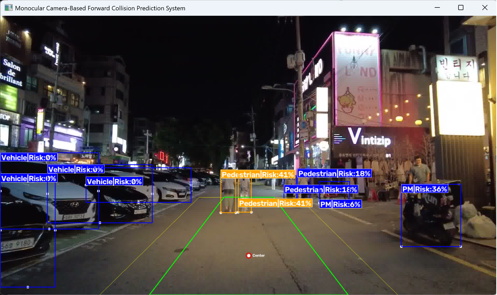

# 생활도로 전방 추돌 위험도 산출 알고리즘 (Python → C++ 이식)

단일 전방 카메라 이미지 시퀀스만으로 골목길 객체의 충돌 위험도를 산출하고,
Safe / Caution / Danger 3단계로 판정하는 알고리즘입니다.
Python으로 구현한 캡스톤디자인 결과물을 C++로 이식해 결과 동일성을 검증하고 실행 시간을 비교했습니다.



▶ 시연 영상: https://youtu.be/LX0IAwTUEaE

## 프로젝트 개요

| 항목 | 내용 |
|---|---|
| 기간 | 2026년 1학기 (캡스톤디자인), 2026년 8월 (C++ 이식, 개인) |
| 팀 구성 | 4인 (C++ 이식·검증은 개인 진행) |
| 담당 | 모델·데이터 탐색, 위험도 알고리즘 전체 구현, C++ 이식·검증·측정 |
| 데이터 | AiHub 주행 이미지 시퀀스 (재배포 제한으로 미포함) |
| 기술 | Python, YOLOv8m, OpenCV / C++17, OpenCV 4.10 DNN, ONNX, CMake, MSVC |

## 파일 구조

| 경로 | 설명 |
|---|---|
| `python/main_code.py` | 원본 구현 (YOLOv8 추론·추적·위험도·시각화) |
| `python/requirements.txt` | Python 패키지 목록 |
| `cpp/main_code.cpp` | C++ 이식본 (OpenCV DNN 추론, IoU 추적기, 위험도 산출) |
| `cpp/verify_cpp.cpp` | 검증용 C++ 프로그램 (시나리오를 C++ 위험도 로직에 입력) |
| `cpp/CMakeLists.txt` | Windows(MSVC) 빌드 설정 (`fcw`, `verify` 두 실행 파일 생성) |
| `verification/verify_python.py` | 무작위 시나리오 생성 + 원본 Python 코드 실행 |
| `verification/verify_compare.py` | Python·C++ 결과 비교 및 판정 분포 출력 |
| `docs/` | 결과 화면 |

## 문제 정의

생활도로는 차선이 불분명하고 보행자·개인형 이동장치(PM)·차량이 섞여 있어 일반 도로용 ADAS로 대응하기 어렵습니다.
또한 깊이 센서 없이 단일 카메라 이미지 시퀀스만 사용해야 하는 제약이 있었습니다.

## 알고리즘

### 1. 시간 위험도 (TTC)
- 프레임 간 바운딩 박스 면적 변화율(AER)로 TTC를 역산 (Nègre et al., 2008)
- 임계값

| 대상 | 위험 | 경고 | 근거 |
|---|---|---|---|
| 차량 | 1.5초 | 4초 | van der Horst & Hogema (1993) |
| 보행자 | 2.5초 | 5초 | 운전자 제동 반응 시간을 고려해 보수적으로 설정 |

- 임계값 사이 구간은 비선형 방정식으로 연속적인 위험도 산출

### 2. 공간 위험도 (ROI)
- Main / Buffer 이중 ROI로 주행 경로 내 객체에 가중치 부여 (이아영 외, 2022 참고)
- ROI 밖 주차 차량 등은 위험도 0으로 억제

### 3. 통합 위험도 (Total Risk Score)

```
Total = 공간 위험도(40) + 시간 위험도(50) + 객체 가중치(10)
```

| 판정 | 범위 |
|---|---|
| Safe | 40 이하 |
| Caution | 40 초과 80 미만 |
| Danger | 80 이상 |

- 회전·이탈 객체에 대한 Edge-Case 예외처리 포함

## 검출 성능

| 모델 | mAP@50 | Precision |
|---|---|---|
| YOLOv8m | 0.88 | 0.85 |

## C++ 이식

### 이식 내용
- YOLOv8m 가중치를 ONNX로 변환, OpenCV DNN으로 추론
- 전처리(레터박스)·후처리(NMS) 직접 구현
- Ultralytics 추적기를 대체하는 IoU 기반 객체 추적기 구현
- ROI 판정·TTC·통합 위험도를 원본과 같은 수식·정수 변환 규칙으로 이식
- 추적 이력 저장 구조를 `std::deque`로 변경

### 결과 동일성 검증
YOLO 검출·추적을 제외한 **위험도 로직**이 원본과 같은 결과를 내는지 검증했습니다.

- 객체 25개, 400프레임(1920×1080)의 무작위 추적 시나리오를 생성 (시드 고정으로 재현 가능)
- 객체 움직임: 접근(박스 확대), 이탈, 좌우 이동, 급격한 위치 변화(회전 상황)
- 원본 Python 코드는 **수정 없이** 실행하고, YOLO 모델·이미지 입력·화면 출력만 가짜로 대체
- C++은 `main_code.cpp`의 `computeRisk()`, `buildFrameContext()`를 그대로 포함해 실행
- 결과: 위험도 값 **1,850건 모두 일치** (판정 분포: SAFE <n> / CAUTION <n> / DANGER <n>)

### 실행 시간 비교
- 조건: 동일 영상 988프레임, CPU, 3회 측정
- 이미지 읽기 / 추론 / 추적 / 위험도 계산 / 시각화 구간별로 같은 위치에 타이머 삽입

| 구간 | Python | C++ | 비율 |
|---|---|---|---|
| 객체당 위험도 산출 (평균) | 17.67 μs | 1.22 μs | **약 14.5배 단축** (회차별 13.9~14.8배) |

#### 전체 처리 속도는 Python이 더 빠른 이유
전체 FPS는 Python이 더 빨랐습니다. 원인을 분석한 결과 언어 차이가 아니라 다음 두 조건의 차이였습니다.
- 추론 엔진: PyTorch vs OpenCV DNN
- 입력 크기: 640×384 vs 640×640

따라서 언어 간 비교는 조건이 같은 **알고리즘 구간(위험도 산출)**으로 한정했습니다.

## 실행 방법

### 0. 저장소 및 모델 다운로드

```bash
git clone https://github.com/tnghdlee/2026_CAPSTONE.git
cd 2026_CAPSTONE
```

모델 가중치는 용량 문제로 [Releases](https://github.com/tnghdlee/2026_CAPSTONE/releases)에 별도로 첨부했습니다.

| 파일 | 용도 | 저장 위치 |
|---|---|---|
| [best.pt](https://github.com/tnghdlee/2026_CAPSTONE/releases/download/v1.0/best.pt) | Python 구현 | `python/` |
| [best.onnx](https://github.com/tnghdlee/2026_CAPSTONE/releases/download/v1.0/best.onnx) | C++ 구현 (OpenCV DNN) | `cpp/` |

터미널에서 받으려면:

```bash
wget -P python https://github.com/tnghdlee/2026_CAPSTONE/releases/download/v1.0/best.pt
wget -P cpp https://github.com/tnghdlee/2026_CAPSTONE/releases/download/v1.0/best.onnx
```

### 1. Python

```bash
cd python
pip install -r requirements.txt
python main_code.py best.pt <이미지 시퀀스 폴더>
```

| 인자 | 설명 |
|---|---|
| `model_path` | 모델 가중치 경로 (`best.pt`) |
| `image_dir` | 입력 이미지 시퀀스 폴더 |
| `--no-display` | 결과 화면 창을 띄우지 않음 (선택) |
| `--device` | 추론 장치 지정, 예: `cpu`, `0` (선택) |

### 2. C++ (Windows, MSVC)

```powershell
cd cpp
cmake -B build -G "Visual Studio 17 2022" -DOpenCV_DIR=<OpenCV 설치 경로>/build
cmake --build build --config Release
.\build\Release\fcw.exe best.onnx <이미지 시퀀스 폴더>
```

| 인자 | 설명 |
|---|---|
| `best.onnx` | ONNX 모델 가중치 경로 |
| `image_dir` | 입력 이미지 시퀀스 폴더 |
| `--no-display` | 결과 화면 창을 띄우지 않음 (선택) |

- 빌드하면 본 프로그램(`fcw.exe`)과 검증 프로그램(`verify.exe`)이 함께 생성됩니다.
- MinGW용 OpenCV 배포판은 MSVC와 호환되지 않으므로 MSVC용(`vc16`) 빌드를 사용해야 합니다.
- 실행 시 `opencv_world4100.dll`을 찾지 못한다는 오류가 나면, `<OpenCV 설치 경로>/build/x64/vc16/bin`을 PATH에 추가하거나 해당 DLL을 실행 파일과 같은 폴더에 복사해주세요.

### 3. 결과 동일성 검증 재현

C++ 빌드를 먼저 완료한 뒤, 저장소 최상위 폴더에서 실행합니다.

```powershell
cd verification
python verify_python.py ..\python\main_code.py
..\cpp\build\Release\verify.exe scenario.csv cpp_risk.txt
python verify_compare.py
```

| 단계 | 출력 |
|---|---|
| 1. 시나리오 생성 + Python 실행 | `scenario.csv`, `py_risk.txt` |
| 2. 같은 시나리오로 C++ 실행 | `cpp_risk.txt` |
| 3. 두 결과 비교 | `[PASS] 1850건 모두 일치합니다.` 및 판정 분포 |

- 검증 단계는 YOLO를 가짜로 대체하므로 `ultralytics` 없이 `opencv-python`, `numpy`만 있으면 실행됩니다.

## 한계 및 개선 방향
- 오르막·내리막에서 ROI가 실제 주행 경로와 어긋나는 문제 → IMU 연동 동적 ROI
- C++ 추론 입력 크기를 Python과 맞춘 전체 파이프라인 재비교

## 참고 문헌
- A. Nègre et al., "Real-Time Time-to-Collision from Variation of Intrinsic Scale," *Experimental Robotics*, Springer, 2008.
- R. van der Horst and J. Hogema, "Time-to-Collision and Collision Avoidance Systems," *Proceedings of the 6th ICTCT Workshop*, Salzburg, 1993.
- 이아영, 이호준, 이경수, "자율주행 인지 모듈의 실시간 성능을 위한 적응형 관심 영역 판단," *자동차안전학회지*, 제14권, 제2호, pp. 20-25, 2022.
- Euro NCAP, "AEB/LSS VRU Test Protocol v4.0.0," 2023.
- ISO, "ISO 15623:2013 Forward Vehicle Collision Warning Systems," 2013.
- Ultralytics, "YOLOv8," GitHub, 2023. https://github.com/ultralytics/ultralytics
- AI Hub, "생활도로 객체인식 자율주행 데이터," 한국지능정보사회진흥원(NIA), 2023. https://www.aihub.or.kr